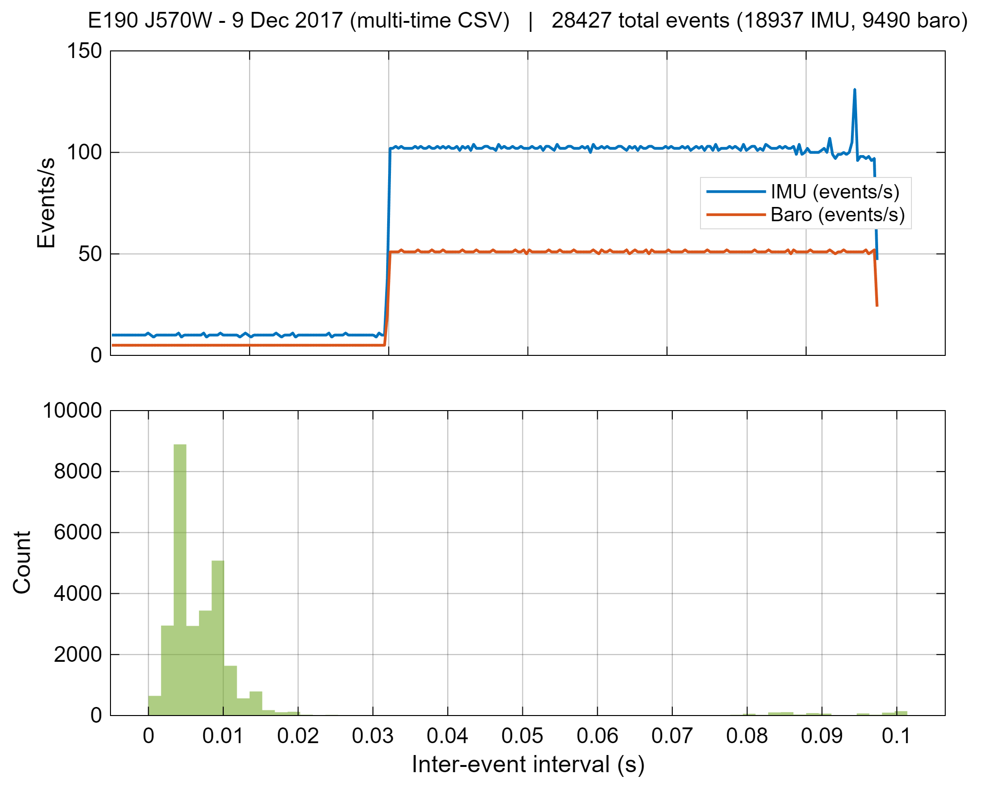
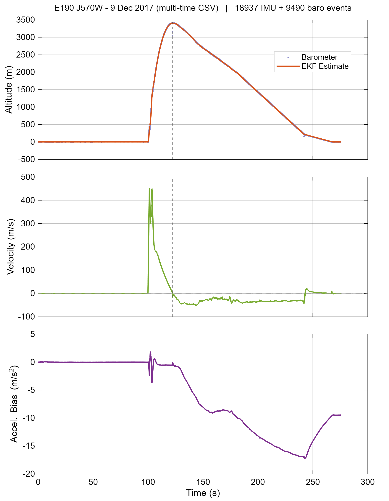
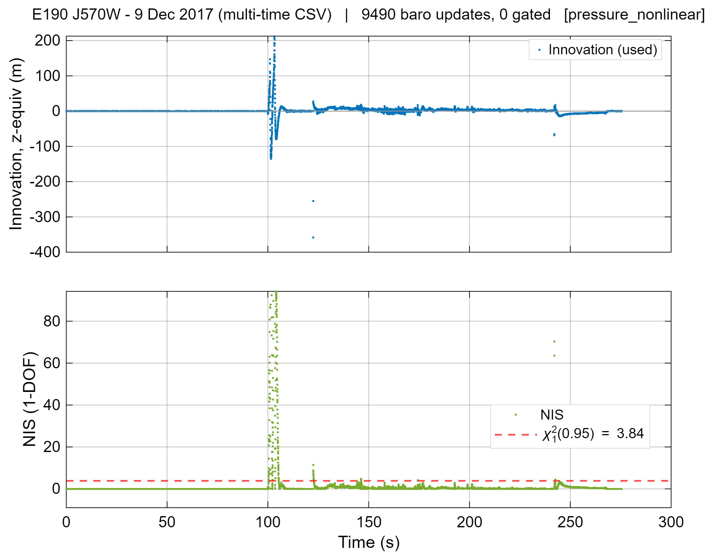
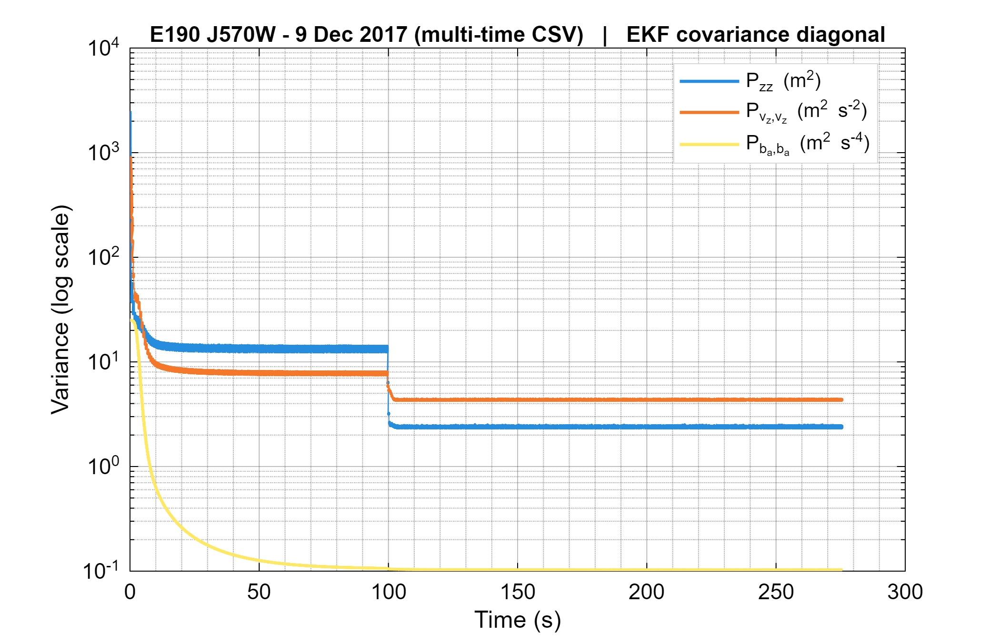
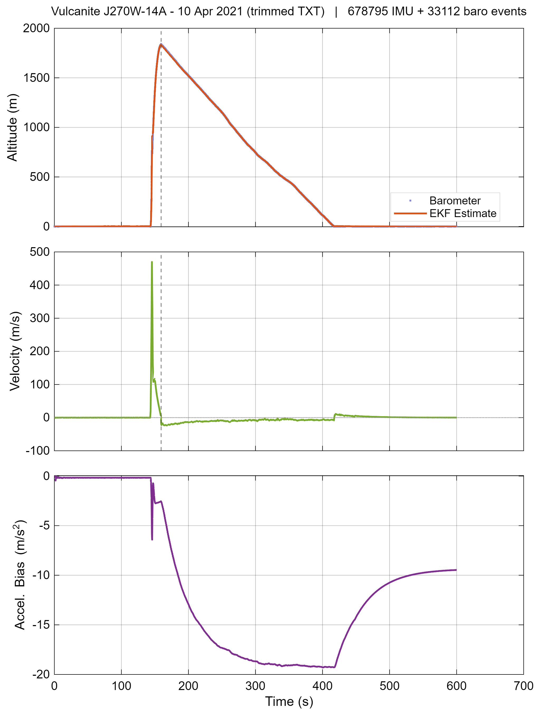
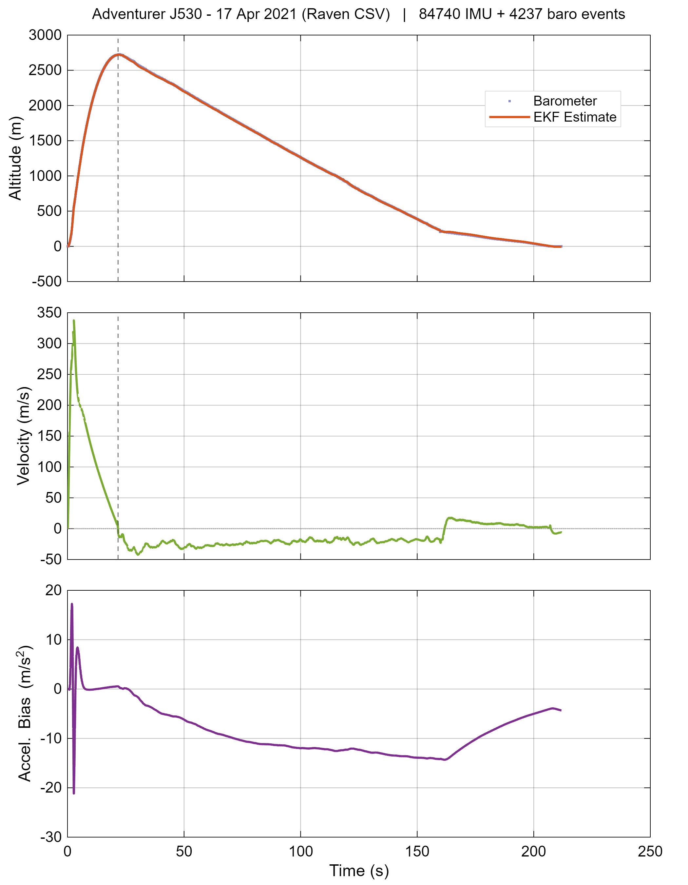
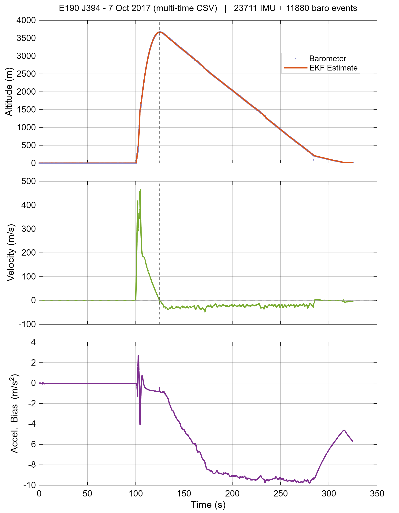

## Slide 0 - Cover

**Offline Rocket Flight State Estimation Using an Extended Kalman Filter**
_Pressure-Domain Nonlinear Measurement Update on 25 Heterogeneous Flights_

- Course: ECE9203 Random Signals — Winter 2026
- Cameron Brooks

> _This project applies the course EKF framework to a real engineering problem: reconstructing the vertical flight trajectory of high-power rockets from onboard sensor logs. The dataset spans 25 flights across four different data loggers, which is what makes it an interesting stress test for a single estimator configuration._

---

## Slide 1 - Background: High-Power Rocketry

- **High-power rocketry (HPR):** amateur / experimental rockets using certified H–O class motors (160 N·s – 40 kN·s total impulse)
- **Typical flight profile:** vertical launch → motor burnout (~1–3 s) → coasting to apogee → parachute recovery (~20–600 s total record)
- **Onboard data loggers** record sensor data throughout flight; reviewed post-flight for performance analysis, motor characterisation, and safety
- **Sensors carried:**
  - Axial accelerometer (IMU) — body-frame specific force, 50–1141 Hz
  - Barometric pressure sensor — absolute pressure, 20–55 Hz
- **This project:** 25 flights from a public DOFPro archive across four commercial logger families — no GPS, no simulation

> _A brief framing slide before the problem setup. HPR flights are a natural testbed for state estimation: the dynamics are fast and highly nonlinear during boost, the sensor suite is minimal, and you only get one shot at the data. The four-family diversity — spanning a 23× range in IMU rates and four different hardware designs — is what makes this a stress test rather than a single-logger validation exercise._

---

## Slide 2 - Problem and Motivation

- **Sensors available:** axial IMU acceleration + barometric pressure — neither gives full state directly
- **Goal:** reconstruct $z$ (altitude), $v_z$ (velocity), $b_a$ (accel bias) from asynchronous logged data
- **Why not just integrate IMU?** Bias drift, vibration — unbounded error without correction
- **Why not just use baro?** No velocity, susceptible to pressure transients
- **EKF fuses both** — bias-corrected IMU drives the predict; baro provides measurement update

> _The core motivation is sensor fusion: IMU gives high-rate dynamics but drifts; baro gives altitude but no velocity. The EKF is the natural framework to combine them with principled noise models. The accelerometer bias state is essential — without it the filter drifts as badly as raw integration._

---

## Slide 3 - Dataset: 4 Families, 25 Flights

- **25 flights total:** 24 real (DOFPro archive) + 1 synthetic emulation reference
- **1 dropped** (Vulcanite G78): physical static-port oscillation under parachute — unrecoverable

| Family           | IMU rate   | Baro rate | Record start    |
| ---------------- | ---------- | --------- | --------------- |
| `emulation_csv`  | 50 Hz      | 50 Hz     | Before launch   |
| `multi_time_csv` | ~70–100 Hz | ~35–37 Hz | Before launch   |
| `raven_csv`      | ~400 Hz    | ~20 Hz    | **At ignition** |
| `trimmed_txt`    | ~1141 Hz   | ~55 Hz    | Before launch   |

- **Cross-validation:** 7 same-day DOFPro + Raven pairs on the same rocket — apogee agreement **< 0.7%**

> _The dataset spans a huge range of logger speeds — from 50 Hz up to 1141 Hz IMU. The Raven family is the most distinct: it starts logging at motor ignition, so there's no pre-launch quiet window for the filter to establish a baseline. That turns out to be important for results. The cross-validation table is the key data-integrity check — we didn't need external GPS to confirm the estimator is working._

---

## Slide 4 - Stochastic Formulation

- Rocket trajectory = **latent random process** observed through noisy sensors
  $$
  x_{k+1} = f(x_k,u_k,\Delta t_k) + w_k,\quad w_k \sim \mathcal{N}(0,Q_k)
  $$
  $$
  y_k = h(x_k) + v_k,\quad v_k \sim \mathcal{N}(0,R_k)
  $$
- State: $x = [z,\ v_z,\ b_a]^\top$
- $Q_k$ — process noise: unmodeled thrust, aero, wind
- $R$ — measurement noise: barometer uncertainty
- Kalman = MMSE estimator under linear-Gaussian assumptions
- $h(z)$ is **nonlinear** (ISA pressure model) → **Extended** Kalman Filter

xk = [z,vz,ba]^T: altitude, velocity, accel bias

> _The stochastic framing is what connects this to the course material. We're not just doing signal processing — we're modeling the trajectory as a random process and the filter is the optimal estimator for that model. The nonlinearity in h(z) is what forces us to use EKF instead of a plain linear KF — that's the central technical point._

---

## Slide 5 - Process Model

- Continuous-time dynamics (linear in state):
  $$
  \dot z = v_z,\quad \dot v_z = u_z - b_a + w_v,\quad \dot b_a = w_b
  $$
  where $u_z = a_\text{IMU} - g$ (≈ 0 on pad, positive during burn)
- Discrete predict at inter-event step $\Delta t$:
  $$
  F_k=\begin{bmatrix}1&\Delta t&-\tfrac12\Delta t^2\\0&1&-\Delta t\\0&0&1\end{bmatrix}
  $$
- Process is linear — $F_k$ is **exact**, not an approximation
- The EKF approximation appears only in the **measurement step**

> _The predict step is a straightforward constant-acceleration kinematic model with a random-walk bias state. Because it's linear, the state Jacobian is exact — no linearization error here. The only place the EKF approximation actually kicks in is the pressure measurement update, which I'll show on the next slide._

---

## Slide 6 - Variable-Step Process Noise

- Covariance prediction: $P_k^- = F_k P_{k-1}^+ F_k^\top + Q_d(\Delta t)$
- $Q_d(\Delta t)$ explicitly scaled by the inter-event interval:
  - `q_vz_psd = 4.0` m²/s³ — velocity disturbance PSD
  - `q_ba_psd = 0.0025` m²/s³ — bias random walk PSD
- **Why variable-step matters:** IMU:baro ratios range from 1:1 to 21:1 across families — no common clock
- Larger $\Delta t$ → proportionally more uncertainty accumulated; no fixed-$Q$ approximation
- `max_dt_sec = 5.0` s clamps unbounded growth on data gaps

> _Because the event stream is asynchronous, the time step between events varies widely. A fixed Q matrix would either over-trust the model on short steps or under-trust it on long ones. Scaling by delta-t is the correct discretization from a continuous-time stochastic model._

---

## Slide 7 - Measurement Model: Why This Is an EKF

- Baro measures **pressure**, not altitude — the conversion is nonlinear (ISA troposphere):
  $$
  h(z)=p_0\!\left(1-\frac{z+z_\text{ref}}{44330.77}\right)^{5.25588}
  $$
- EKF linearizes at each **update**: $H_k=\bigl[\tfrac{\partial h}{\partial z},\ 0,\ 0\bigr]$
- Altitude-domain tuning parameter $r_\text{baro}$ [m²] → pressure-domain: $R_\text{eff} = H_k^2\, r_\text{baro}$
- `r_baro_var = 64 m²` → $\sigma_P \approx 94$ Pa (conservative but defensible across 4 families)
- **Linear KF would update in altitude domain** — EKF updates in pressure domain, closer to the physical measurement

> _This is the core EKF justification. We receive pressure samples, not altitude. Inverting the ISA formula before the update would lose information about the measurement uncertainty structure. Instead we keep the measurement in pressure units and let the EKF Jacobian handle the linearization at every update step. This also means the noise parameter stays interpretable in metres._
> Even if actual sensor noise is lower (1–7 Pa), this is:
>
> 1.  intentionally conservative
> 2.  necessary due to:
>
> - vibration
> - port effects
> - cross-device variability

---

## Slide 8 - Update, Covariance, and Gating

- Standard innovation and gain: $\nu_k = y_k - h(x_k^-)$, $K_k = P_k^-H_k^\top S_k^{-1}$
- **Joseph covariance form** (not $P^+ = (I-KH)P^-$):
  $$
  P_k^+=(I-K_kH_k)P_k^-(I-K_kH_k)^\top + K_kR_kK_k^\top
  $$
  Preserves symmetry and positive-definiteness under finite-precision arithmetic
- **NIS:** $\text{NIS}=\nu_k^2/S_k$ — $\chi^2(1)$ with mean 1.0 for a consistent filter

> speak to:

- **Innovation gating: disabled** across all 25 flights
  - Fixed-threshold NIS rejection consistently gates valid baro updates during high-dynamic boost, where large innovations reflect real physics not sensor faults; phase-selective approaches require reliable launch-phase labelling across four logger families
  - ±4400 Pa J510W end-of-record artifact absorbed without divergence on a converged filter — demonstrating robustness to isolated late-record spikes

> _The Joseph form is a minor but important implementation detail — the simpler I minus KH form can lose positive-definiteness on short time steps. On innovation gating: I tried enabling it with various thresholds and it always failed on at least one flight family by starving the filter of baro updates during the highest-dynamic phase. Leaving it off and accepting all measurements was the only robust choice across 25 diverse flights._

---

## Slide 9 - Asynchronous Replay Architecture

- IMU + baro merged by timestamp → one sorted event stream
  - Tie-break: IMU first on equal timestamps
- **At every event:** predict step with held $u_z$ (zero-order hold)
- **At baro events only:** measurement update
- No resampling — variable-step $Q_d(\Delta t)$ handles non-uniform intervals

_Two distinct dt histogram peaks confirm healthy interleaved IMU and baro streams (~2:1 ratio)._

> _The replay architecture is what makes the pipeline work across logger families with such different rates. There's no interpolation or resampling — each sensor contributes events at its own natural rate and the filter steps through them in time order. The event timeline figure is the health check: two clear peaks in the dt histogram means both streams are feeding the filter correctly._

---

## Slide 10 - Parameter Selection

All chosen by **physical reasoning**, not grid search:

| Parameter     | Symbol           | Value        | Meaning                     |
| ------------- | ---------------- | ------------ | --------------------------- |
| `q_vz_psd`    | $q_{v_z}$        | 4.0 m²/s^5    | Unmodeled accel PSD         |
| `q_ba_psd`    | $q_{b_a}$        | 0.0025 m²/s³ | Bias random walk            |
| `r_baro_var`  | $r_\text{baro}$  | 64 m²        | Baro noise (σ = 8 m)        |
| `init_var_z`  | $\sigma_z^2$     | 2500 m²      | Altitude prior (σ = 50 m)   |
| `init_var_vz` | $\sigma_{v_z}^2$ | 900 m²/s²    | Velocity prior (σ = 30 m/s) |
| `init_var_ba` | $\sigma_{b_a}^2$ | 25 m²/s⁴     | Bias prior (σ = 5 m/s²)     |

- Broad velocity prior (σ = 30 m/s) covers Raven flights that start at motor ignition
- Single parameter set runs across all 4 families without per-flight tuning

> _Every parameter has a physical justification I can walk through. The large velocity prior is the most interesting — it has to be wide enough that the filter doesn't reject the very first high-g Raven samples during boost. The baro noise of 8 metres sounds large, but it corresponds to about 94 Pascals in pressure units, which is defensible when you account for airframe vibration and four different sensor types._

---

## Slide 11 - Initialization

- **Specific-force:** $u_z = a_\text{IMU} - g$ — reads ≈ 0 on pad, positive during burn
- **Launch-relative baro:** $z_0 \approx 0$ regardless of site elevation; reference = median of first 200 baro samples
- **Initial state:** $x_0 = [z_0,\ 0,\ 0]^\top$, $P_0 = \text{diag}(2500,\ 900,\ 25)$
- $z_0$ overridden to first finite launch-relative baro sample before filter loop
- **Pre-launch convergence:** 20–60 s static pad window drops $P_{zz}$ from 2500 → < 100 m² before liftoff

> _Initialization is straightforward but the launch-relative convention matters: it means the altitude estimate starts near zero on every flight regardless of where the launch site is, so the filter's prior covers the initial uncertainty properly. Flights with a pad window converge quickly; Raven flights start cold at ignition and the wider prior is what keeps them stable._

---

## Slide 12 - Primary Result: T1-A J570W

_apogee = 2674 m | final_z = −0.2 m | NIS mean = 3.49 | Raven cross-val: 0.2%_

- Altitude tracks baro throughout; $v_z$ crosses zero cleanly at apogee (~t = 45 s)
- Bias converges during pre-launch pad phase → stable at ≈ −3.5 m/s²
- Final $\sqrt{P_{zz}} \approx 2$ m — well-converged at landing

> _This is the cleanest result in the dataset — a full-duration flight with a pad window, good baro signal, and an independent Raven logger on the same rocket for cross-validation. The minus 0.2 metre final altitude is essentially exact. The slightly elevated NIS I'll explain on the next slide — it's a near-apogee barometer sensitivity effect, not a filter problem._

---

## Slide 13 - Innovation and Covariance Diagnostics (T1-A)

### Slide: Innovation & NIS Diagnostics

* **Pre-launch (static phase)**

  * Innovation ≈ 0, NIS ≈ 0
  * Filter fully converged; strong model–measurement agreement

* **Launch transient**

  * Large innovation spike (high dynamics)
  * NIS ≫ χ² threshold (3.84)
  * Expected model mismatch during rapid acceleration

* **Post-transient flight**

  * Innovation centered at zero (no bias)
  * NIS ~1–3 (statistically consistent regime)

* **Localized effects**

  * Near-apogee: elevated NIS (reduced baro sensitivity)
  * Occasional spikes from isolated measurement artifacts

* **Overall**

  * NIS mean = 3.49 (dominated by launch + localized spikes)
  * Filter shows correct transient → convergence behavior

---

### Speaker Notes

* **Pre-launch:**
  The system is stationary, so the EKF has time to converge. The innovation collapses toward zero, and NIS is near zero because both the residual and predicted uncertainty are very small. This indicates strong agreement and a well-initialized filter.

* **Launch transient:**
  At ignition, dynamics change abruptly. The process model cannot instantly capture this, so the predicted state lags reality. This produces a large innovation. Because the covariance has not yet expanded, the residual is large relative to expected uncertainty, causing a sharp NIS spike. This is expected and indicates the filter detecting a transient mismatch.

* **Post-transient:**
  The filter rapidly adapts. Innovation becomes zero-mean again, showing no bias. NIS settles into the expected range (~1–3), indicating reasonable consistency between the model and measurements.

* **Near-apogee behavior:**
  Around apogee, pressure sensitivity to altitude decreases. This reduces observability, so the same absolute measurement noise produces larger normalized residuals, increasing NIS locally.

* **Overall interpretation:**
  The elevated NIS mean (3.49) is not representative of steady-state behavior—it is driven primarily by the launch transient and a small number of localized effects. The dominant pattern is correct: transient inconsistency followed by stable convergence, which is characteristic of a properly functioning EKF.

* **Optional deeper point (if asked):**
  The magnitude of the launch spike suggests the process noise is slightly underestimated during boost. This is a known tradeoff when using fixed Q across all flight regimes.

---

---

## Slide 14 - Fleet Results: T1 Flights

|          | T1-A J570W | T1-B J270W | T1-C J530 Raven | T1-D J394 |
| -------- | ---------- | ---------- | --------------- | --------- |
| Apogee   | 2674 m     | 1549 m     | ~1600 m\*        | 2905 m    |
| NIS mean | 3.49       | **0.83**   | 0.57            | 2.73      |
| final_z  | −0.2 m     | −0.2 m     | −1104 m†        | +14.2 m‡  |

\* ascent only †body reorientation ‡synoptic pressure drift

> _The fleet summary table is the central quantitative result. T1-A and T1-B represent nominal filter behaviour (final_z within −0.2 m). T1-C and T1-D are explained anomalies shown on the next slide. The 14/16 non-Raven ±5 m figure is the key fleet-wide claim._

---

## Slide 15 - Two Anomaly Cases

### T1-C: Raven Post-Apogee Divergence (all 9 Raven flights)

- No gyroscope in Raven source files
- After apogee, rocket flips nose-down — axial IMU now measures **descent deceleration**, not thrust
- EKF integrates reoriented signal as sustained downward acceleration → −1000 to −1700 m by landing
- **Ascent is correct** — all Raven apogees within 0.7% of cross-validation pair
- Fix requires attitude data — absent from source files

### T1-D: Synoptic Pressure Drift (+14.2 m)

- Frontal system on 7 Oct 2017: ~1.7 hPa pressure drop over 220 s flight
- Filter anchors to launch-time baro — genuine pressure change **indistinguishable from altitude**
- **Not a filter error** — fundamental limit of single-sensor baro without GPS

> _Both anomalies are explained physical causes, not filter failures. The Raven divergence is actually a useful result — it clearly demonstrates what happens when the IMU axis assumption breaks down, which makes the case for why attitude data matters. The J394 case illustrates the inherent limitation of barometric altimetry that GPS or pressure telemetry would solve._

---

## Slide 16 - What Worked / Next Steps

**What worked**

- Nonlinear pressure EKF: process stays linear, nonlinearity only at measurement update
- Variable-step $Q_d(\Delta t)$: correct uncertainty accumulation, no resampling
- Joseph form: positive-definiteness across all 25 flights, zero covariance floor events
- Gating off: ±4400 Pa J510W shutdown spike absorbed, final_z = −2.2 m
- **14/16 non-Raven within ±5 m; all 25 return finite final state**

**Next steps**

- Gyroscope + attitude integration → resolve Raven post-apogee divergence
- Per-family Q/R tuning (trimmed_txt NIS < 1 → mildly conservative)
- RTS smoother for offline trajectory refinement
- Baro bias as 4th state for slow synoptic drift

> _The main takeaway is that a single fixed EKF configuration, tuned by physical reasoning alone, runs correctly across 25 flights from four completely different loggers. The two failures are both explained by missing data — attitude for Raven, absolute pressure reference for J394 — not by deficiencies in the filter design._

---

## Slide 17 - Demo and Q&A

**Live demo** (`project/matlab/`)

1. `main.m` — `active_flight_index = 1` → T1-A J570W (clean full flight)
2. `active_flight_index = 3` → T1-C Raven J530 (post-apogee divergence)
3. `active_flight_index = 4` → T1-D J394 (+14.2 m synoptic drift)

**Reproducibility**

- `data.m` → `main.m` — complete two-script run path
- `_report_artifacts/tables/final_per_flight_metrics.csv` — all 25 flights, all metrics

**Q&A**

> _I can run any of the three demo flights live and show the console output and figures. The main.m notebook is designed to be read top to bottom as a technical demo — the run controls at the top let you switch between flights with one number change._
