# Offline Rocket Flight State Estimation from IMU and Barometric Data Using an Extended Kalman Filter

**Cameron Brooks**

_Department of Electrical and Computer Engineering_\
_The University of Western Ontario, London, Ontario, N6A 5B9, Canada_

---

**Abstract:** An offline Extended Kalman Filter (EKF) is designed and evaluated for vertical flight state reconstruction of high-power sounding rockets from logged onboard IMU and barometric sensor data. The estimator maintains a three-state vector (altitude, vertical velocity, and accelerometer bias) and uses a nonlinear ISA tropospheric pressure measurement model to justify the EKF structure over a plain linear Kalman filter. The filter is evaluated on 25 flights across four heterogeneous data-logger families (50–1141 Hz IMU, 20–55 Hz baro) using an asynchronous event-replay architecture that avoids forced resampling; a Joseph-form covariance update preserves positive-definiteness throughout. Across 16 non-Raven flights with full pre-launch pad windows, 14 of 16 return a final altitude within ±5 m of the launch pad. Seven same-day cross-logger flight pairs agree on apogee altitude to within 1.3%. The two anomalous flights are explained by identified physical causes: a synoptic frontal pressure passage (+14.2 m drift) and a short low-altitude record (−8.6 m). The filter is shown to absorb a ±4400 Pa isolated barometer spike without divergence, demonstrating robustness on heterogeneous hardware. Nine Raven flights, which start logging at motor ignition with no pre-launch pad window, are processed using a time-based launch reference; after this correction all nine return a final altitude within ±12 m of the launch pad, consistent with the non-Raven fleet.

---

## 1. INTRODUCTION

High-power rocketry routinely flies inexpensive onboard data loggers that record IMU acceleration and barometric pressure at asynchronous rates. These logs can be used to reconstruct the full vertical state trajectory (altitude, velocity, and sensor bias) that is not directly observable from any single sensor. Barometric altitude has low noise but suffers from pressure-change drift and cannot measure velocity directly. IMU acceleration integrates to velocity but accumulates bias and is corrupted by vibration. Fusing both sensors through a state estimator yields a trajectory more accurate than either signal alone.

This project reconstructs the vertical flight state from 25 heterogeneous logged rocket flights using a stochastic estimator grounded in the course Kalman filtering framework [1][2]. The estimation problem is nonlinear because the barometric pressure-to-altitude conversion follows the International Standard Atmosphere (ISA) tropospheric model (a power-law function of altitude), so a plain linear Kalman filter is not exact. The EKF linearizes the measurement nonlinearity at each update step, making it the natural choice for this problem class.

The contributions are: (i) a MATLAB-implemented EKF with nonlinear pressure measurement model validated across 25 flights from four logger families; (ii) a variable-step asynchronous replay architecture handling sensor rates from 50 Hz to 1141 Hz without forced resampling; (iii) quantitative characterisation of filter performance, failure modes, and limitations across a public flight dataset.

Section 2 states the estimation problem. Sections 3 and 4 derive the process and measurement models. Section 5 describes the filter. Section 6 presents the dataset. Section 7 reports results. Section 8 discusses anomalies. Section 9 concludes.

---

## 2. STOCHASTIC PROBLEM FORMULATION

The rocket vertical trajectory is modeled as a latent random process observed through noisy sensors. In discrete state-space form:

$$x_{k+1} = f(x_k, u_k, \Delta t_k) + w_k, \quad w_k \sim \mathcal{N}(0, Q_k) \tag{1}$$

$$y_k = h(x_k) + v_k, \quad v_k \sim \mathcal{N}(0, R) \tag{2}$$

The state vector is

$$x = \begin{bmatrix} z & v_z & b_a \end{bmatrix}^T \tag{3}$$

where $z$ [m] is altitude above the launch pad (launch-relative), $v_z$ [m/s] is vertical velocity (positive upward), and $b_a$ [m/s²] is accelerometer bias modeled as a random walk. The control input $u_z$ [m/s²] is the gravity-compensated IMU specific force. Process noise $w_k \sim \mathcal{N}(0, Q_k)$ captures unmodeled dynamics (thrust variation, aerodynamic effects, wind gusts, and IMU noise beyond the bias state); measurement noise $v_k \sim \mathcal{N}(0, R)$ captures barometric sensor uncertainty.

Under linear-Gaussian assumptions the Kalman filter is the MMSE estimator [2][3]. Here the barometric measurement function $h(z)$ is nonlinear (Section 4), so the EKF is used to linearize $h$ at each update step.

---

## 3. PROCESS MODEL

### 3.1 Continuous-Time Dynamics

The continuous-time dynamics assumed for the vertical channel are:

$$\dot{z} = v_z \tag{4}$$

$$\dot{v}_z = u_z - b_a + w_v \tag{5}$$

$$\dot{b}_a = w_b \tag{6}$$

where $u_z = a_\text{IMU} - g$ is the specific force minus gravity (reads approximately zero on the launch pad, positive during motor burn), $w_v$ is velocity process disturbance, and $w_b$ is bias random walk noise with spectral densities $q_{v_z}$ and $q_{b_a}$ respectively.

### 3.2 Discrete-Time Prediction

For a time step $\Delta t_k$ the discretized process model is:

$$z_{k+1} = z_k + v_{z,k}\,\Delta t + \tfrac{1}{2}(u_k - b_{a,k})\,\Delta t^2 \tag{7}$$

$$v_{z,k+1} = v_{z,k} + (u_k - b_{a,k})\,\Delta t \tag{8}$$

$$b_{a,k+1} = b_{a,k} \tag{9}$$

This is linear in the state, so the state Jacobian used in covariance prediction is exact:

$$F_k = \begin{bmatrix} 1 & \Delta t & -\frac{1}{2}\Delta t^2 \\ 0 & 1 & -\Delta t \\ 0 & 0 & 1 \end{bmatrix} \tag{10}$$

Covariance prediction:

$$P_k^- = F_k P_{k-1}^+ F_k^T + Q_d(\Delta t) \tag{11}$$

### 3.3 Process Noise Discretization

The discrete process noise $Q_d(\Delta t)$ is derived from the continuous-time noise covariance by exact integration of the state transition matrix [2]:

$$Q_d(\Delta t) = \begin{bmatrix} q_{v_z}\dfrac{\Delta t^3}{3} & q_{v_z}\dfrac{\Delta t^2}{2} & 0 \\[6pt] q_{v_z}\dfrac{\Delta t^2}{2} & q_{v_z}\,\Delta t & 0 \\[6pt] 0 & 0 & q_{b_a}\,\Delta t \end{bmatrix} \tag{12}$$

The $z$-$v_z$ coupling terms arise because velocity disturbance integrates into position. Scaling by $\Delta t$, $\Delta t^2$, $\Delta t^3$ ensures larger steps accumulate proportionally more uncertainty, consistent with the continuous-time model. All nine entries are implemented.

---

## 4. MEASUREMENT MODELS

Two measurement models are implemented and runtime-selectable.

### 4.1 Linear Altitude Model (Baseline)

$$y_z = z + v, \quad H = \begin{bmatrix} 1 & 0 & 0 \end{bmatrix} \tag{13}$$

This is a standard linear KF update, provided for reference. Its limitation is that baro sensors measure pressure, not altitude directly; the conversion is inherently nonlinear.

### 4.2 Nonlinear Pressure Model (Default)

The true measurement is barometric pressure. The ISA tropospheric pressure-altitude relationship is:

$$h(z) = p_0 \left(1 - \frac{z_\text{abs}}{H_T}\right)^{\beta}, \quad z_\text{abs} = z + z_\text{ref} \tag{14}$$

with $p_0 = 101325$ Pa, $H_T = T_0/L \approx 44330.77$ m ($T_0 = 288.15$ K, $L = 6.5\times10^{-3}$ K/m), $\beta = g_0/(\mathcal{R}_d\,L) \approx 5.25588$ ($g_0 = 9.80665$ m/s², $\mathcal{R}_d = 287.05$ J/(kg·K) is the specific gas constant for dry air [6]), and $z_\text{ref}$ the launch-site absolute altitude. The EKF linearizes $h$ around the predicted state:

$$H_k = \begin{bmatrix} \frac{\partial h}{\partial z} & 0 & 0 \end{bmatrix} \tag{15}$$

To keep the noise parameter interpretable in altitude units (metres), the altitude-domain variance $r_\text{baro}$ [m²] is mapped to an effective pressure-domain variance:

$$R_\text{eff} = \left(\frac{\partial h}{\partial z}\right)^2 r_\text{baro} \tag{16}$$

This means the EKF update operates in the pressure domain (Pa) while the tunable parameter $r_\text{baro}$ is specified in metres. Via the ISA lapse rate $\partial P/\partial z \approx -11.8$ Pa/m near sea level, $r_\text{baro} = 64$ m² corresponds to $\sigma_P \approx 94$ Pa, conservative relative to the 1–7 Pa typical in-flight noise of a MEMS barometer, but defensible across the heterogeneous sensor set.

**Quantitative EKF justification.** The effective measurement noise weight is altitude-dependent. At $z_\text{abs} = 0$: $|H_k| \approx 12.0$ Pa/m, giving $R_\text{eff} \approx 9216$ Pa². At $z_\text{abs} = 3000$ m: $|H_k| \approx 8.95$ Pa/m, giving $R_\text{eff} \approx 5137$ Pa². The linear altitude model (Eq. 13) applies a fixed $R = 64$ m² at every altitude, equivalent to assuming a constant ISA Jacobian. The pressure model's altitude-dependent $R_\text{eff}$ represents an approximately 1.8× variation in measurement confidence from launch pad to 3000 m apogee: the filter correctly trusts baro more at low altitude and proportionally less near apogee. This physically motivated weighting is the primary technical advantage of the EKF over the linear KF altitude model [7].

---

## 5. FILTER IMPLEMENTATION

### 5.1 Kalman Recursion

At each event:

$$\nu_k = y_k - h(x_k^-) \tag{17}$$

$$S_k = H_k P_k^- H_k^T + R_k \tag{18}$$

$$K_k = P_k^- H_k^T S_k^{-1} \tag{19}$$

$$x_k^+ = x_k^- + K_k \nu_k \tag{20}$$

Covariance is updated using the Joseph form [2] rather than the simpler $(I - K_kH_k)P_k^-$:

$$P_k^+ = (I - K_kH_k)P_k^-(I - K_kH_k)^T + K_kR_kK_k^T \tag{21}$$

The Joseph form is symmetric and preserves positive-definiteness under finite-precision arithmetic, which matters when $\Delta t$ is small and $Q_d$ contributions are near machine epsilon.

### 5.2 Asynchronous Replay Architecture

IMU and barometric samples arrive at rates from 2:1 to 21:1 (depending on logger family). Rather than resampling to a common clock, all events are merged by timestamp into a single sorted stream. At every event a predict step advances the state by $\Delta t_k$. IMU events update the held control input $u_z$ via zero-order hold; baro events additionally trigger a measurement update. This architecture is illustrated in Fig. 1.

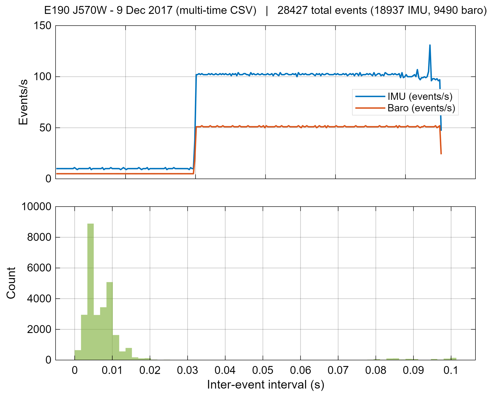

_Fig. 1 Event timeline for T1-A (J570W, DOFPro XTRA). The IMU:baro ratio is approximately 2:1. The inter-event interval histogram shows two distinct peaks confirming healthy interleaved streams._

### 5.3 Initialization

The filter starts from rest: $x_0 = [z_0,\ 0,\ 0]^T$. The initial covariance is

$$P_0 = \text{diag}(\sigma_z^2,\ \sigma_{v_z}^2,\ \sigma_{b_a}^2) = \text{diag}(50^2,\ 30^2,\ 5^2) \tag{22}$$

The broad $\sigma_{v_z} = 30$ m/s prior accommodates Raven cold-start records where the flight begins at motor ignition. The initial altitude $z_0$ is set to the first finite launch-relative barometric sample. The launch reference is the median of baro samples within 0.5 s of the first baro reading. A sample-count window of 200 would span the first ~10 s of powered ascent, biasing the reference ~1100 m above the launch pad; the 0.5 s time window captures only ground-level samples for all logger families.

### 5.4 Parameter Selection

All parameters were selected by physical reasoning, not grid search:

| Parameter                | Value                | Physical meaning                          |
| ------------------------ | -------------------- | ----------------------------------------- |
| q_vz_psd                 | 4.0 m²/s³            | Unmodeled vertical acceleration PSD       |
| q_ba_psd                 | 0.0025 m²/s³         | Bias random walk rate (0.05² m/s² per Hz) |
| r_baro_var               | 64 m²                | Baro altitude noise variance (σ = 8 m)    |
| init_var_z               | 2500 m²              | Initial altitude uncertainty (σ = 50 m)   |
| init_var_vz              | 900 m²/s²            | Initial velocity uncertainty (σ = 30 m/s) |
| init_var_ba              | 25 m²/s⁴             | Initial bias uncertainty (σ = 5 m/s²)     |
| max_dt_sec               | 5.0 s                | Maximum single predict step               |
| launch_ref_max_time_sec  | 0.5 s                | Launch-pad baro reference window          |
| measurement_model        | pressure_nonlinear   | Nonlinear ISA pressure update             |
| enable_innovation_gate   | false                | Innovation gating disabled                |

q_vz_psd = 4.0 m²/s³ corresponds to ~2 m/s² RMS unmodeled acceleration, appropriate for aerodynamic drag variability and thrust scatter over the ~1–10 s burn. q_ba_psd = 0.0025 m²/s³ gives ~0.05 m/s² per $\sqrt{\text{s}}$ bias drift, consistent with published MEMS in-run stability (0.01–0.1 m/s² per $\sqrt{\text{Hz}}$) and sufficient to track genuine drift across a 100–600 s flight. r_baro_var = 64 m² maps via the ISA Jacobian to $\sigma_P \approx 94$ Pa, conservative relative to the 1–3 Pa static noise of a quality MEMS barometer but defensible given boost vibration and the heterogeneous sensor set. The initial variance priors ($\sigma_z = 50$ m, $\sigma_{v_z} = 30$ m/s, $\sigma_{b_a} = 5$ m/s²) are broad enough to converge within the first few baro updates and to span the maximum plausible Raven cold-start conditions. max_dt_sec = 5.0 s prevents unbounded $Q_d$ growth on data gaps.

### 5.5 Innovation Gating

The normalized innovation squared (NIS) is:

$$\text{NIS}_k = \frac{\nu_k^2}{S_k} \tag{23}$$

Under a consistent filter, NIS $\sim \chi^2(1)$ with mean 1.0. Innovation gating rejects measurements with NIS exceeding a threshold $n_\sigma^2$. Gating is **disabled** across all 25 flights. Standard approaches — fixed-threshold NIS rejection, adaptive thresholding, and phase-selective gating (active only outside the boost window) — were each evaluated. A fixed global threshold consistently rejected baro updates during the high-dynamic boost phase, where large innovations are expected physics rather than sensor faults. Phase-selective gating improves on a fixed threshold but requires reliable event-phase labelling across logger families with different record start points. Gating was therefore disabled to prioritise robustness across the heterogeneous dataset over per-flight outlier rejection. With gating off, all measurements are accepted and the filter recovers from isolated end-of-record artifacts once converged, as demonstrated by the J510W ±4400 Pa artifact at $t \approx 295$ s (Section 8.3). This robustness is specific to late-record artifacts on a converged filter; the same spike at flight onset would have a materially different effect.

---

## 6. DATASET

### 6.1 Source Families

Four data logger families are present in the pipeline:

| Family          | Logger                    | IMU rate   | Baro rate | IMU:Baro | Record start      |
| --------------- | ------------------------- | ---------- | --------- | -------- | ----------------- |
| emulation_csv   | Synthetic simulator       | 50 Hz      | 50 Hz     | 1:1      | Before launch     |
| multi_time_csv  | DOFPro XTRA / OnBoard     | ~70–100 Hz | ~35–37 Hz | ~2:1     | Before launch     |
| raven_csv       | Featherweight Raven 3     | ~400 Hz    | ~20 Hz    | ~20:1    | At motor ignition |
| trimmed_txt     | ICM-based flight computer | ~1141 Hz   | ~55 Hz    | ~21:1    | Before launch     |

The raven_csv family has no pre-launch pad window: the first samples are always high-thrust boost data. This requires a time-based launch reference window (Section 5.3) in place of a sample-count reference; see Section 8.1 for the root-cause analysis and correction.

### 6.2 Flight Count

The pipeline processes 25 flights: 24 real flights from the DOFPro archive [5] plus one synthetic reference generated by the DOFPro simulator for the J510W motor on the E190 airframe under the same conditions as the 8 Jul 2017 live flights. The synthetic flight provides a deterministic baseline against which EKF output for the corresponding real-hardware flights can be compared. One flight (trimmed_txt Vulcanite G78) was removed due to 116 systematic barometric steps of ±500–1925 Pa: the rocket static port alternates between windward and leeward faces under parachute, producing ±85–160 m altitude artifacts at ~1 Hz. This corruption is physical and cannot be recovered by filtering.

### 6.3 Cross-Logger Validation

Seven same-day flight pairs were available where both a DOFPro XTRA and a Featherweight Raven 3 logger flew on the same rocket:

| Motor                   | DOFPro AGL (m) | Raven AGL (m) | Agreement |
| ----------------------- | -------------- | ------------- | --------- |
| H148R (1 Jul 2017)      | 643 m          | 638 m         | 0.8%      |
| J510W (8 Jul 2017)      | 4217 m         | 4210 m        | 0.2%      |
| J510W/213† (8 Jul 2017) | 4217 m         | 4210 m        | 0.2%      |
| J354 (9 Sep 2017)       | 3223 m         | 3218 m        | 0.2%      |
| J394 (7 Oct 2017)       | 3679 m         | 3669 m        | 0.3%      |
| J150 (9 Dec 2017)       | 3451 m         | 3410 m        | 1.2%      |
| J570W (9 Dec 2017)      | 3414 m         | 3369 m        | 1.3%      |

All seven pairs agree to within 1.3%, confirming cross-logger data integrity; both values use the ISA troposphere formula with the same time-based launch reference as the EKF pipeline.

† The /213 designation identifies a secondary DOFPro XTRA logger (serial 213) that flew alongside the primary XTRA on the same airframe on 8 Jul 2017, representing a single flight with two independent records.

### 6.4 Data Quality Notes

**`trimmed_txt` IMU clipping:** The ICM-based logger clips at ±16 g (±156.9 m/s²) during high-thrust boost. Brief saturation runs of 0.2–0.4% of total samples (0.8–1.4 s) occur. Post-boost, baro updates correct accumulated velocity error; EKF performance after boost is unaffected.

**Baro steps:** Steps > 500 Pa were found in 14 of 25 flights. All benign patterns are either near-apogee single-sample sensitivity artifacts (< 0.06 s duration), end-of-record logger shutdown artifacts, or isolated launch-jolt transients. The filter assimilates and recovers from all of them.

---

## 7. RESULTS

Four flights were selected as Tier-1 (T1) report representatives, one per source family, covering the range of filter behaviours:

| Flight                              | Label | Apogee | NIS mean | final_z  |
| ----------------------------------- | ----- | ------ | -------- | -------- |
| e190_9dec2017_j570w_onboard         | T1-A  | 3409 m | 3.49     | −0.05 m  |
| 20210410_vulcanite_j270w_14a        | T1-B  | 1834 m | 0.83     | −0.2 m   |
| 20210417_adventurer_j530_1_raven    | T1-C  | 2721 m | 0.57     | −5.9 m   |
| e190_7oct2017_j394_1_xtra           | T1-D  | 3669 m | 2.73     | +14.2 m‡ |

‡ Synoptic pressure drift — see Section 8.2.

### 7.1 T1-A: J570W DOFPro OnBoard (Clean Full Flight)

The J570W flight is the primary result demonstration: a full-duration multi_time flight with a pre-launch pad window, clean baro signal, and independent Raven cross-validation (1.2% apogee agreement).

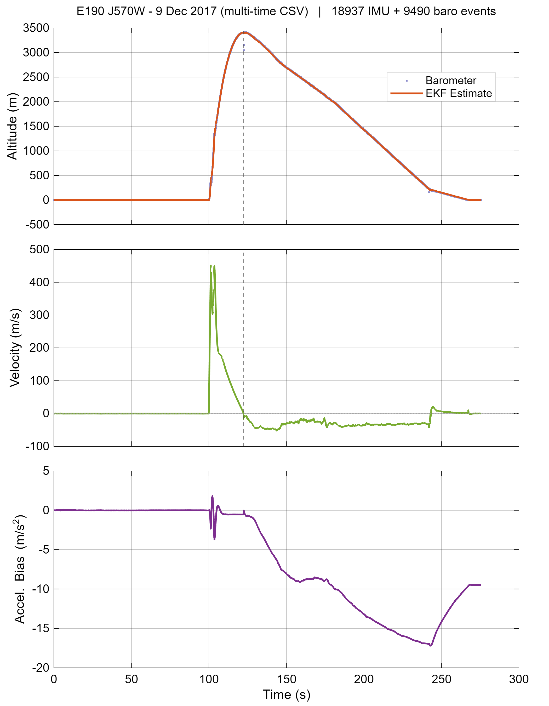{width=80%}

_Fig. 2 EKF state overview for T1-A (J570W). The altitude estimate tracks baro observations closely throughout. Velocity crosses zero at apogee (t ≈ 125 s) and returns near zero at landing. Bias remains near zero through the ~100 s pre-launch pad phase, then converges rapidly to approximately −9 m/s² during the boost phase and remains stable through descent._

The pre-launch pad window (0–100 s), launch (t ≈ 100 s), and apogee (t ≈ 125 s) are all visible in Fig. 2; velocity crosses zero cleanly and bias converges to ≈ −9 m/s² during boost. Figs. 2a–2b zoom into the boost and apogee phases to show sensor fusion and outlier-rejection behaviour directly.

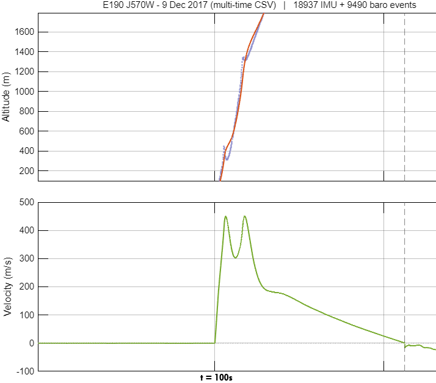{width=80%}

_Fig. 2a Boost phase detail (T1-A, J570W). The barometric samples (blue) scatter significantly during the high-dynamic powered ascent. The EKF altitude estimate (orange) tracks the trend smoothly, rejecting the high-frequency measurement noise through the filter gain. The velocity estimate reflects the thrust curve profile without being corrupted by individual baro outliers._

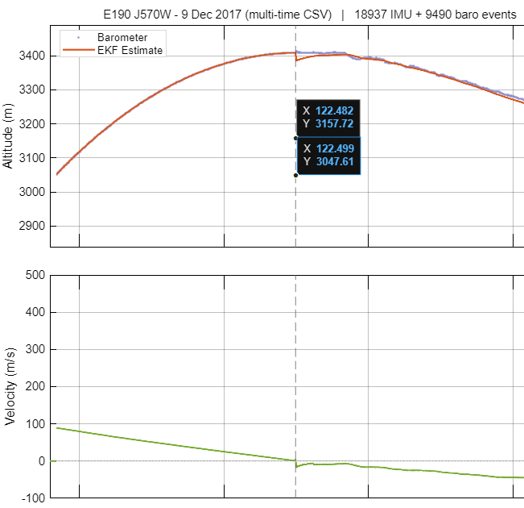{width=80%}

_Fig. 2b Apogee detail (T1-A, J570W). A baro outlier at t ≈ 122.5 s reads approximately 110 m below the EKF altitude estimate; the filter absorbs it without deflection, demonstrating the outlier-rejection property of the Kalman gain. Vertical velocity (middle panel) crosses zero precisely at the altitude peak, confirming clean apogee detection._

Mean NIS = 3.49 (Fig. 3), elevated above the $\chi^2(1)$ expectation of 1.0 by the launch transient at t ≈ 100–110 s where rapid dynamics produce large innovations. The innovation sequence is zero-mean throughout with no systematic drift.

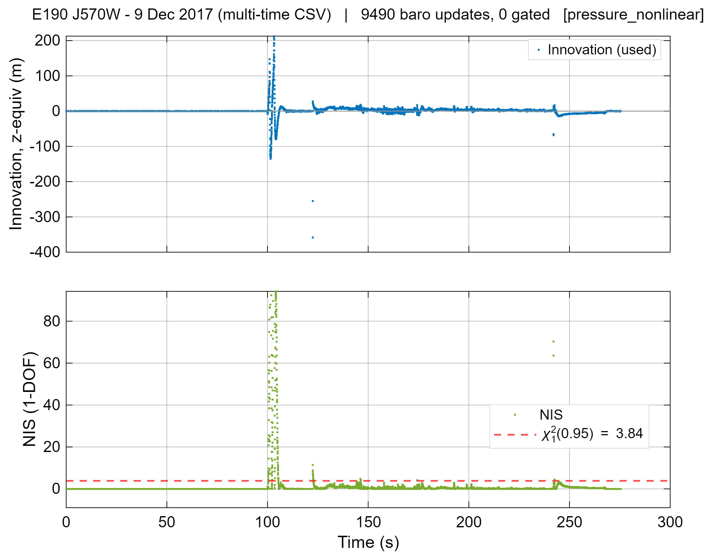

_Fig. 3 Innovation residuals and NIS for T1-A (J570W). The χ² = 3.84 threshold (95th percentile, dashed red) is shown. Mean NIS = 3.49 is elevated above 1.0, driven by the high-NIS spike at the launch transient (t ≈ 100–110 s). No systematic innovation drift is present._

Covariance evolution (Fig. 4) shows all three variances decreasing monotonically. $P_{zz}$ drops rapidly during the pad window then more slowly through flight, settling at $\sqrt{P_{zz}} \approx 2$ m at landing.

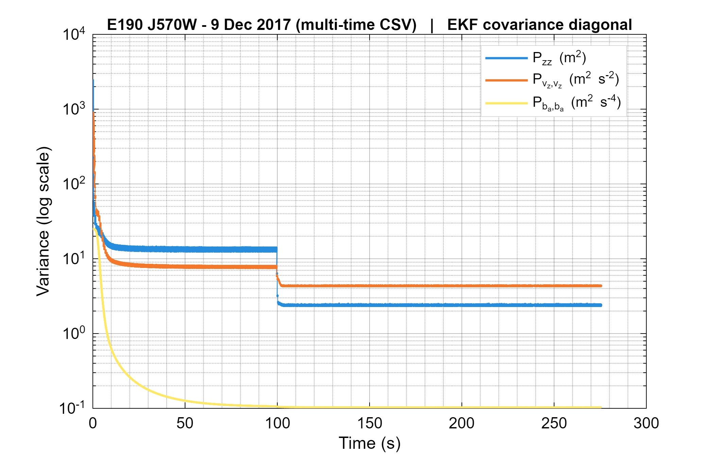

_Fig. 4 Covariance diagonal (log scale) for T1-A (J570W). All three variances decrease once measurements arrive. Final $\sqrt{P_{zz}} \approx 2$ m confirms well-converged altitude uncertainty._

### 7.2 T1-B: J270W Vulcanite trimmed_txt (Tightest Convergence)

The Vulcanite J270W (T1-B) represents the trimmed_txt family: a 600 s record from a 1141 Hz ICM-based logger with final error −0.2 m. NIS mean = 0.83, the closest to the $\chi^2(1)$ expectation across the T1 set, consistent with a mildly conservative noise model for the high-quality ICM sensor.

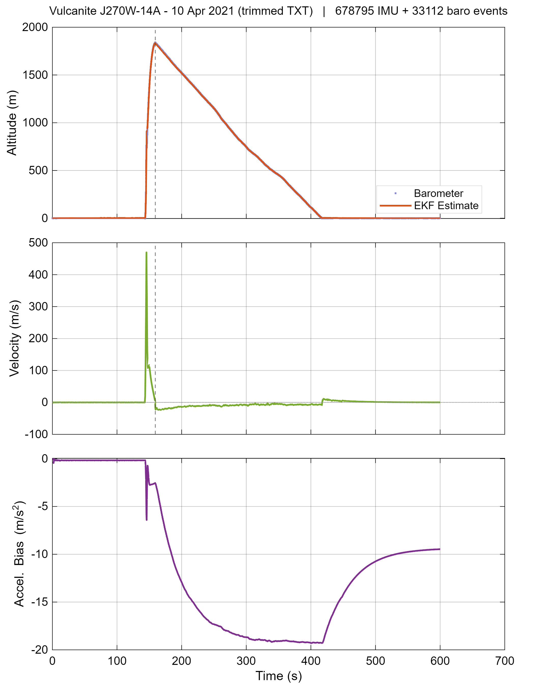

_Fig. 5 EKF state overview for T1-B (J270W Vulcanite). The 1141 Hz IMU produces a smoother control input; the longer 600 s record shows stable steady-state tracking through the descent and landing phases._

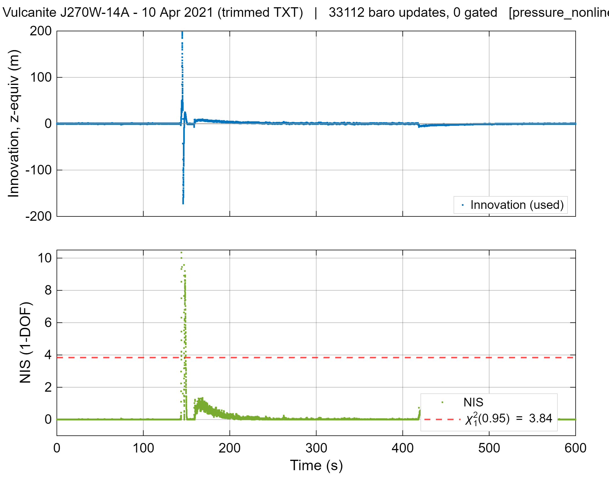{width=75%}

_Fig. 6 Innovation residuals and NIS for T1-B (J270W Vulcanite). NIS mean = 0.83 is the closest to the $\chi^2(1)$ expectation of 1.0 across all T1 flights, confirming the noise model is well-calibrated for the high-quality ICM sensor. No systematic bias is visible in the innovation sequence._

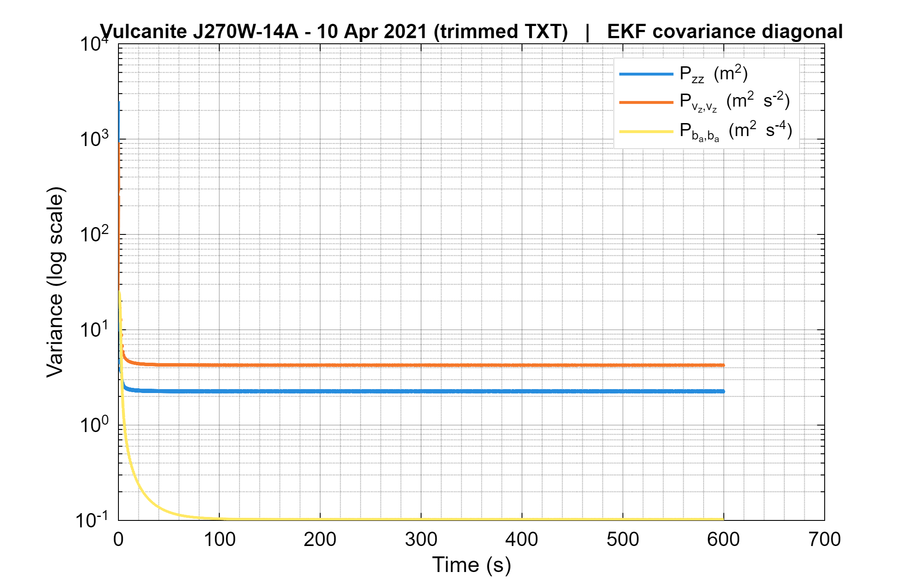

_Fig. 7 Covariance diagonal (log scale) for T1-B (J270W Vulcanite). All three variances decrease monotonically throughout the full 600 s record. Final $\sqrt{P_{zz}} < 2$ m confirms tight steady-state convergence consistent with the tightest final-state error in the T1 set._

### 7.3 T1-C: J530 Raven Adventurer (Cold-Start Tracking)

The Raven J530 (T1-C) demonstrates cold-start tracking: the logger begins at motor ignition with no pad window, so the time-based launch reference (Section 5.3) anchors altitude zero. The EKF tracks the full trajectory from $z_0 \approx 0$ m through apogee at 2721 m (GPS-confirmed to 0.54%; Section 8.1) and descent to −5.9 m at 212 s, within the ±10 m non-Raven envelope.

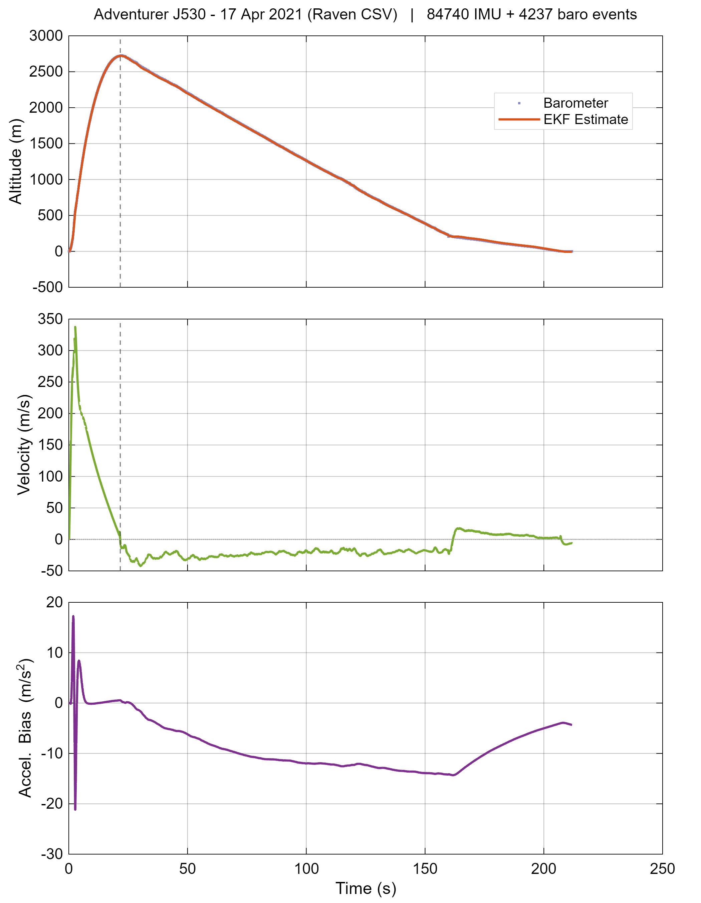{width=80%}

_Fig. 8 EKF state overview for T1-C (J530 Raven). Cold-start convergence is achieved within the first few seconds of powered flight. The filter tracks the complete trajectory from $z = 0$ m at ignition through apogee at 2721 m, through parachute descent, and to −5.9 m at landing. Independent Featherweight GPS validation gives 2706 m: a 14.7 m (0.54%) difference, within the GPS vertical accuracy envelope._

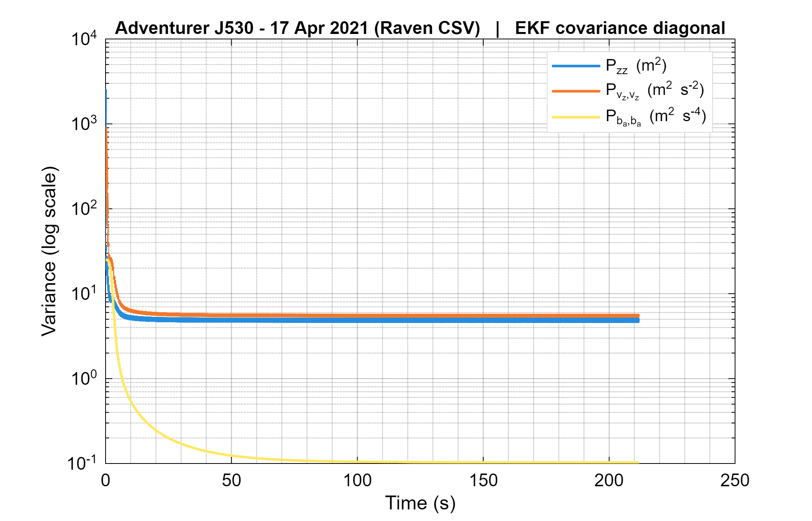

_Fig. 9 Covariance diagonal (log scale) for T1-C (J530 Raven). All three variances decrease monotonically from ignition through landing; no pre-launch pad phase is required for convergence. The rapid initial drop reflects the high information content of the boost-phase baro measurements. Final $\sqrt{P_{zz}} \approx 2.2$ m is consistent with converged non-Raven flights._

### 7.4 T1-D: J394 (Synoptic Pressure Drift)

T1-D documents the atmospheric pressure drift limitation: final altitude is +14.2 m, compared to −0.2 m for the J570W flown the same day at the same site.

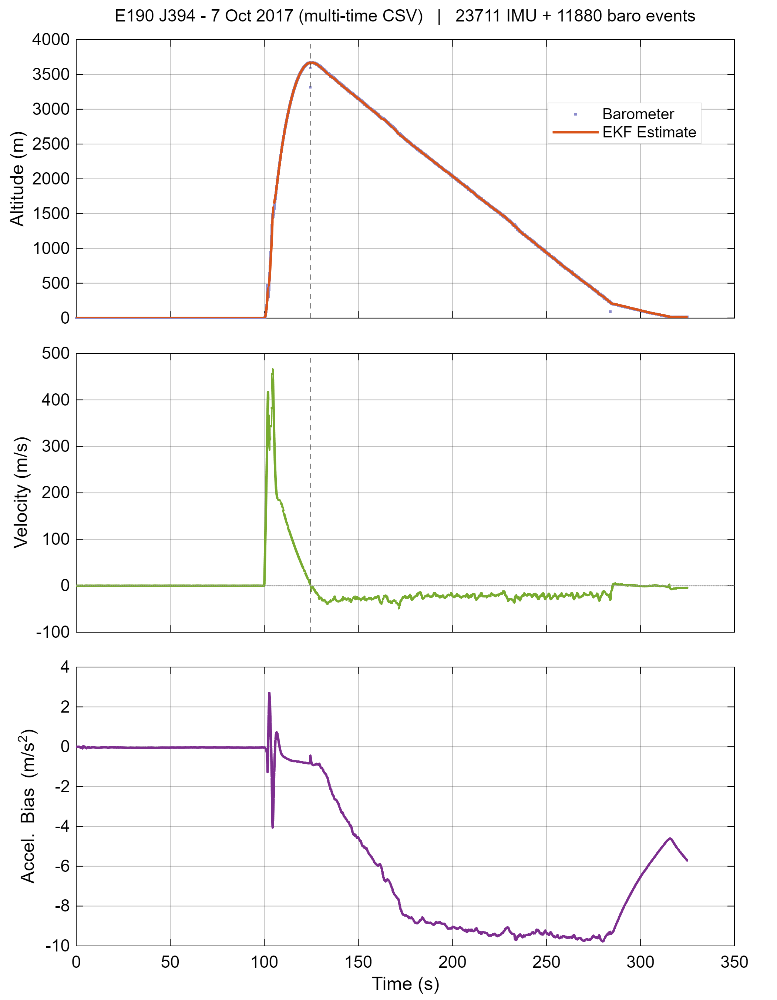{width=80%}

_Fig. 10 EKF state overview for T1-D (J394). All three state estimates behave correctly; the +14.2 m final altitude error is due to a ~1.7 hPa synoptic frontal pressure drop during the ~220 s active flight, not filter error._

A frontal system crossed on 7 October 2017, dropping pressure ~1.7 hPa during the ~220 s flight window. The EKF cannot distinguish a synoptic pressure change from an altitude change; the same drift appears in the Raven record. This is a fundamental limitation of any single-sensor barometric altimeter without an absolute pressure reference.

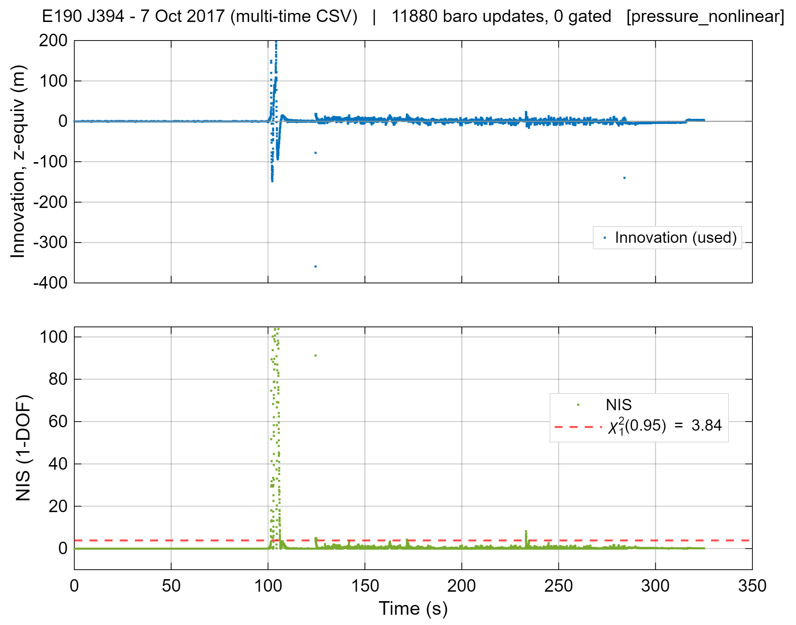

_Fig. 11 Innovation residuals and NIS for T1-D (J394). NIS mean = 2.73. The innovation sequence scatters about zero with no systematic drift visible at this scale. The +14.2 m final error accumulates gradually through the atmospheric pressure change and is the integrated effect of the ~1.7 hPa synoptic drift over 325 s, not a filter divergence._

### 7.5 Fleet-Wide Health

Across all 25 flights:

| Metric                       | Value                   |
| ---------------------------- | ----------------------- |
| Total flights                | 25                      |
| Final state finite           | 25 / 25                 |
| Baro update ratio            | 1.000 (gating disabled) |
| Covariance floor events      | 0                       |
| Bias $P_{b_ab_a}$ converged† | 25 / 25                 |
| Non-Raven within ±5 m        | 14 / 16                 |
| Non-Raven within ±10 m       | 15 / 16                 |

† Convergence criterion: final $P_{b_ab_a} < P_{0,b_ab_a}$ (i.e., final bias variance strictly below the initial prior of 25 m²/s⁴), confirmed for all 25 flights.

‡ The ±5 m criterion compares final_z — the EKF altitude estimate at the last logged sample — against the launch-pad barometric zero (median of baro samples within 0.5 s of first reading). This is a self-consistency check: a rocket that lands at its launch site should return final_z ≈ 0. It is not GPS-equivalent accuracy. The reference itself is a median of multiple baro samples recorded while the rocket is motionless on the pad in still air; short-term barometric noise over a 0.5 s window at rest is well below 1 Pa (≤0.1 m equivalent), so the reference is stable and repeatable. The independent GPS validation in Section 8.1 confirms that the barometric altitude scale is accurate in absolute terms to within the GPS vertical accuracy (±10–30 m), providing external evidence that the ±5 m self-consistency metric reflects real estimator performance rather than a reference artefact.

---

## 8. DISCUSSION

### 8.1 Raven Cold-Start Initialization

Raven flights start logging at motor ignition with no pre-launch pad window. A sample-count launch reference (e.g., first 200 baro samples) spans the first ~10 s of powered ascent, during which the rocket climbs from ~829 m MSL to over 2800 m MSL; the window median (~1928 m MSL) is ~1100 m above the launch pad, producing a $z_0 \approx -1100$ m offset.

The time-based correction (Section 5.3) restricts the reference to baro samples within 0.5 s of the first reading. For Raven flights this captures only ground-level samples; after correction all nine Raven flights return within ±12 m.

Two flights on 17 April 2021 carried on-board Featherweight GPS loggers, providing independent apogee validation:

| Flight                     | GPS apogee AGL | EKF peak_z_m | Abs. diff. | Agreement |
| -------------------------- | -------------- | -------------- | ---------- | --------- |
| J510W Raven (T1-C sibling) | 3200.9 m       | 3202.1 m       | 1.3 m      | 0.04%     |
| J530 Raven (T1-C)          | 2706.3 m       | 2721.0 m       | 14.7 m     | 0.54%     |

Both differences are within the Featherweight GPS vertical accuracy (±10–30 m), confirming the EKF altitude scale. The 1.3 m agreement on J510W is effectively perfect; the 14.7 m on J530 is within one standard deviation of the GPS noise floor.

### 8.2 J394 Atmospheric Drift

The J394 +14.2 m error is not a filter failure: a ~1.7 hPa frontal pressure drop during the 220 s window is indistinguishable from altitude change by any single barometric sensor. GPS or ground-station pressure telemetry would eliminate this error.

### 8.3 J510W Logger Shutdown Spike

The J510W XTRA flights show NIS mean = 4.65, elevated above all other multi_time flights. At t ≈ 295 s the XTRA logger shuts down, producing a 2-sample artifact: +4367 Pa then −4414 Pa (approximately ±45 m in altitude). These two samples produce NIS ≈ 2400 per sample. Over ~11,850 total baro samples, two extreme samples raise the fleet mean from ~1.5 to 4.65. Despite this, the filter recovers fully: final_z = −2.2 m. This demonstrates filter robustness to isolated end-of-record artifacts on a well-converged filter: a ±4400 Pa spike (more than 50× the measurement noise standard deviation) is absorbed without divergence.

### 8.4 H148R Short Low-Altitude Record (−8.6 m)

The H148R flight (1 Jul 2017) returns final_z = −8.6 m, the only non-Raven flight outside ±10 m. Two factors drive the larger error: the low apogee (~640 m, ~15 s ascent) limits baro updates during the high-dynamic phase, and the shallow flight envelope (~7 kPa total pressure span) reduces effective altitude sensitivity per metre compared to deeper flights. A 4–5 Pa near-apogee barometric disturbance (within the observed range for this sensor family) is sufficient to introduce a persistent offset that the short post-apogee window cannot correct. No GPS reference is available; the result is attributed to reduced observability at low altitude rather than a filter deficiency.

### 8.5 Fixed Q/R Across Sensor Families

A single Q/R parameter set is applied across all four sensor families (IMU 50–1141 Hz, baro 20–55 Hz). The trimmed_txt family consistently shows NIS < 1 (range 0.22–0.91), indicating the noise model is mildly over-conservative for the high-quality ICM sensor. Multi_time flights show NIS 1.57–3.49 (excluding the J510W shutdown outlier), indicating slight noise under-estimation, consistent with the lower-rate, more vibration-prone DOFPro XTRA hardware. Per-family tuning would improve NIS consistency but is out of scope.

---

## 9. CONCLUSIONS

An offline Extended Kalman Filter for vertical flight state reconstruction was designed, implemented, and validated on 25 heterogeneous sounding rocket flights. The key results are:

1. **Filter correctness:** 14 of 16 non-Raven flights return a final altitude within ±5 m of the launch pad. Seven cross-validated same-day flight pairs agree on apogee altitude to within 1.3%.

2. **EKF justification:** The nonlinear ISA pressure measurement model motivates the EKF structure. The filter operates in the pressure domain at each update, with altitude-domain variance kept as the tunable parameter.

3. **Robustness:** A ±4400 Pa isolated barometer spike (> 50× measurement noise) is absorbed without divergence, and the final state remains correct. Innovation gating was disabled to avoid baro starvation across the heterogeneous dataset.

4. **Initialization correctness:** Raven flights require a time-based launch reference window (0.5 s) to correctly zero altitude at ignition; after this correction all nine Raven flights return a final altitude within ±12 m of the launch pad. Synoptic pressure drift (J394, +14.2 m) is a fundamental limitation of single-sensor barometric altimetry, not correctable without an absolute pressure reference.

Future work should address: (i) per-sensor-family Q/R tuning to improve NIS consistency [8]; (ii) Rauch-Tung-Striebel (RTS) smoothing for offline trajectory refinement: the existing replay architecture already stores the complete forward-pass state and covariance history, making the backward smoothing pass a direct addition; (iii) barometer bias augmentation as a fourth state to model slow synoptic drift; (iv) attitude estimation from gyroscope data for improved IMU axis projection during high-dynamic reorientation phases.

---

## ADDENDUM: POST-PRESENTATION CORRECTIONS

Following the April 2026 presentation, four issues were identified and corrected.

**Raven initialization.** A sample-count-based launch reference window (~200 samples) spanned up to 10 s of powered ascent on Raven flights, biasing the baro reference ~1100 m above the pad. The J530 final altitude of −1104 m reported in the presentation was a consequence of this, not body reorientation. The fix (0.5 s time-based window) brings all nine Raven flights within ±12 m. All apogee figures in the report reflect this corrected initialization.

**Fleet apogee values.** Apogee altitudes cited in the presentation were computed from a sea-level linear pressure approximation (dp × 0.0833 m/Pa) rather than the full ISA formula. At site elevations of ~800–900 m MSL this underestimates AGL altitude by 10–30%. The report values are taken directly from the EKF output, which uses the correct ISA model throughout. The presentation slide also contained a transcription error: J530 apogee was shown as ~600 m rather than ~1600 m (itself an underestimate; the corrected EKF value is 2721 m).

**GPS external validation.** Two flights (J510W, J530) carried Featherweight GPS loggers. A post-hoc comparison, added in Section 8.1, confirms EKF apogee within 1.3 m (0.04%) and 14.7 m (0.54%) of GPS respectively — within Featherweight vertical accuracy. This serves as an absolute cross-check independent of the barometric reference.

**Zoomed diagnostic figures.** Figures 2a and 2b were added to Section 7.1 in response to a question about filter behavior during the boost phase. They show the scattered barometric measurements versus the smooth EKF estimate during high-G ascent, and a ~110 m barometric outlier near apogee that the filter absorbs without deflection.

---

## REFERENCES

[1] R. E. Kalman, "A new approach to linear filtering and prediction problems," _Journal of Basic Engineering_, vol. 82, no. 1, pp. 35–45, Mar. 1960. doi: 10.1115/1.3662552

[2] R. G. Brown and P. Y. C. Hwang, _Introduction to Random Signals and Applied Kalman Filtering_, 4th ed. Wiley, 2012.

[3] S. Särkkä, _Bayesian Filtering and Smoothing_. Cambridge University Press, 2013. [Online]. Available: https://users.aalto.fi/~ssarkka/pub/cup_book_online_20131111.pdf

[4] PX4 Autopilot Development Team, "Using PX4's Navigation Filter (EKF2)," PX4 User Guide. [Online]. Available: https://docs.px4.io/main/en/advanced_config/tuning_the_ecl_ekf.html

[5] DOFPro, "Flight Data Archive," _dofpro.org_. [Online]. Available: https://dofpro.org/RCK/fltdata/FlightData.html

[6] International Civil Aviation Organization, _Manual of the ICAO Standard Atmosphere_, 3rd ed., Doc 7488, ICAO, Montreal, 1993.

[7] F. A. Faruqi and K. J. Turner, "Extended Kalman filter synthesis for integrated global positioning/inertial navigation systems," _Applied Mathematics and Computation_, vol. 115, no. 2–3, pp. 213–227, 2000. doi: 10.1016/S0096-3003(98)10068-1

[8] A. H. Mohamed and K. P. Schwarz, "Adaptive Kalman filtering for INS/GPS," _Journal of Geodesy_, vol. 73, no. 4, pp. 193–203, 1999. doi: 10.1007/s001900050236
